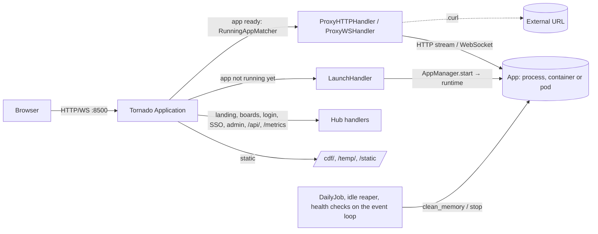

# Architecture

## Overview



It is one Python process running one asyncio event loop, which Tornado uses. There are no extra threads, except an executor that runs blocking work such as `conda env list`, password hashing, LDAP binds, SMTP, SQLite (usage and sessions) and waiting on process trees. The HTTP listener and the optional HTTPS listener share one `Application`. The same code runs on Linux and Windows. Every OS-specific branch lives in [platform_utils.py](../streamhub/platform_utils.py), described in [windows-compatibility.md](windows-compatibility.md).

## The `Hub` object

[app.py](../streamhub/app.py) builds one `Hub` that owns all runtime state:

| Attribute | Type | Role |
|---|---|---|
| `settings` | `config.Settings` | Typed config ([configuration.md](configuration.md)) |
| `catalog` | `catalog.Catalog` | Apps, boards, users and news, re-read when their files change |
| `manager` | `launcher.AppManager` | Running app instances and launches in progress, their runtimes, idle reaper, health checks, usage store (`usage.UsageStore`) and failure counts |
| `ports` | `ports.PortAllocator` | Internal port leases |
| `notifier` | `notify.Notifier` | Slack, Teams and email channels (async, never raise) |
| `oidc` | `handlers.sso.OidcProvider` | OpenID provider discovery document, cached for an hour |
| `sessions` | `sessions.SessionStore` | Session inventory and revocations, reloaded every 5 s |
| `login_throttle`, `report_throttle` | `auth.LoginThrottle` | Login attempts per client IP (10 failures per 5 min, attempts in progress included); issue reports per client IP (5 per 10 min) |
| `auth_slots` | `asyncio.Semaphore` | At most 8 password checks at once; a login waits up to 10 s for one, then gets 503 |
| `draining`, `active_requests` | `bool`, `int` | Set during shutdown; proxied HTTP requests in progress |
| `internal_token` | `str` | Random per process. Authenticates the built-in tools to `/api/`, signs the identity headers, and derives each app's `STREAMHUB_APP_KEY`. |

## Request routing

Routes are tried in order ([app.py:86](../streamhub/app.py#L86)):

| Pattern | Handler | Purpose |
|---|---|---|
| `/`, `/<name>.brd/` | `pages.BoardPageHandler` | Landing page (boards, favorites, latest news, apps of the board `""`) and board pages. `/` redirects to `/setup/` while `auth.needs_setup`. |
| `/news/` | `pages.NewsPageHandler` | Every announcement |
| `/login/`, `/logout/` | `account.*` | Local and LDAP login, signed session cookie. Logout is a POST. |
| `/login/oidc/`, `/login/oidc/callback` | `sso.*` | OpenID Connect login |
| `/setup/` | `setup.SetupHandler` | First-run setup: creates the first admin while there is none ([Access control](#access-control)) |
| `/report/?id=` | `apps.ReportHandler` | Developer contacts; the POST sends an issue report |
| `/out/<id>/` | `apps.OutHandler` | Tail of the app log |
| `/admin/` | `admin_page.AdminPageHandler` | Native admin page |
| `/api/`, `/api/health`, `/api/apps`, `/api/apps/<id>/status`, `/api/apps/<id>/start\|stop\|restart` | `admin.*`, `apps.*` | JSON API |
| `/metrics` | `admin.MetricsHandler` | Prometheus metrics |
| `/api/apps/<id>/log\|affinity`, `/api/admin/state\|ports\|environments\|path-check\|sessions\|files/<key>\|git/<action>` | `admin_page.*` | Admin page API |
| `/api/admin/docker…` | `docker_admin.*` | Docker tab: state, container actions and logs, image pull and remove |
| `/api/admin/cdf…` | `cdf_admin.*` | Static files tab: list, upload, rename, delete, new folder |
| `/api/admin/backup`, `/api/admin/restore` | `backup_admin.*` | Backup tab: download, and validated restore |
| `/api/admin/temp/purge` | `admin_page.TempPurgeHandler` | Dashboard: empty the temp folder (`Hub.purge_temp`) |
| `/status.cmd/…` | `RedirectHandler` | 301 to `/admin/` (the 2.0 dashboard) |
| `/update/`, `/clear/`, `/restart/`, `/exit/` | `admin.*` | Admin actions (GET shows a confirmation page, POST runs it) |
| `/(clear\|exit\|restart).cmd/` | `admin.LegacyCommandHandler` | Redirects from the 1.x URLs |
| `/static/*`, `/favicon.ico` | Tornado's `static_path` | The UI stylesheet, the logo and icons ([static/brand/](../streamhub/static/brand/)), and Bootstrap and Font Awesome ([static/vendor/](../streamhub/static/vendor/)), with versioned URLs (`static_url`). Tornado serves `/favicon.ico` from the same folder. |
| `/cdf/*`, `/temp/*` | `StaticFileHandler` | Public static files |
| WebSocket to a ready app | `proxy.ProxyWSHandler` | Matched by `RunningAppMatcher(websocket=True)` |
| Any other request to a ready app | `proxy.ProxyHTTPHandler` | Matched by `RunningAppMatcher(websocket=False)` |
| `/<id>/…` | `apps.LaunchHandler` | Starts the app, or shows its loading or error page |
| `/<id>` | `apps.AppRedirectHandler` | Adds the trailing slash |

`RunningAppMatcher` ([proxy.py:37](../streamhub/proxy.py#L37)) is a custom Tornado `Matcher`. It reads the first path segment, looks it up in `AppManager`, and matches only when that app is ready. The upgrade header decides between the WebSocket and HTTP handlers. Nothing is added to or removed from the route table at runtime, and app IDs are never compiled into regular expressions.

## Access control

[auth.py:131](../streamhub/auth.py#L131) (`can_access_app`) runs on every launch, proxy, status and output request:

- `help.cmd` is public.
- An app with `min_role` (none of the built-ins since 2.1) requires that role.
- Admins can reach every app.
- Any other app is reachable when **one of its boards** is the landing page (`""`), a public board, or a protected board the user has (`*` covers all).

**First admin.** `auth.needs_setup` is true while nobody can administer the hub: no local admin in a valid users file, no `STREAMHUB_ADMIN_PASSWORD`, and neither OIDC nor LDAP configured (their admins come from `group-mapping`). In that state the hub logs `Hub.setup_token` and a link to `/setup/?token=…` at startup (`Hub.announce_setup`, again at most once a minute from the login and setup pages), and `/` redirects to `/setup/`. [handlers/setup.py](../streamhub/handlers/setup.py) shows one form; without the token in the URL, it starts with a token field that says where to find the token (the container ID from `platform_utils.container_name` for `docker logs`). It accepts only that token, or a link that contains it (`hmac.compare_digest` on bytes); a wrong one shows the form again with an error. Under `Hub.setup_lock`, it checks `needs_setup` again, adds the admin to the users file (`bootstrap.add_admin`, hashed in the executor), writes `site-title` and `team-name` and reloads, then signs the admin in. The token is random per process. Once an admin exists, `/setup/` is a 404.

Role checks for admin pages are in [handlers/base.py](../streamhub/handlers/base.py) (`require_login`, `require_role`). `/admin/` and its API need a manager; the file editors, Docker, static files, the JSON editor and git need an admin. Every form POST, and every JSON POST from the admin page (`X-XSRFToken` header), must carry the XSRF token. The proxy handlers skip that check, because apps manage their own CSRF.

**Sessions.** The signed `user` cookie holds `{name, source, role, boards}`, a random session ID and the login time (`auth.session_value`). `Hub.user_from_cookie` first refuses the cookie if [sessions.py](../streamhub/sessions.py) has its session revoked, or all sessions of its user issued before a revocation, or if it is an SSO session older than `sso-session-minutes`. Logins and revocations are written to `sessions-db` (SQLite) at once, and every instance reloads the revocations every 5 seconds, so a revoked session is refused everywhere within 5 seconds. Logout revokes the session. Then `auth.user_from_session` ([auth.py:291](../streamhub/auth.py#L291)) reads the cookie back:

| Source | Role and boards come from |
|---|---|
| `local` | The users file, on every request: edits and removals apply at once |
| `oidc`, `ldap` | The users-file entry with the same name **and the same `source`**, if any; otherwise the cookie (the group mapping at login time, until the session expires) |

An SSO login never takes over a local account of the same name, and users-file entries with an SSO `source` can't log in with a password. While the users file is unusable (`Catalog.users_error`), it grants nothing and SSO logins and sessions are refused, since an override in it can't be read ([configuration.md](configuration.md#users-file-streamhub-usersjson)). A 2.0 cookie (a bare user name) is read as a local user; cookies from before 2.2 have no session ID and can only be revoked with all of their user's sessions.

**Single sign-on.**

- **OIDC** ([handlers/sso.py](../streamhub/handlers/sso.py)): the authorization code flow with PKCE. `state`, `nonce` and the code verifier sit in a signed `oidc` cookie for 10 minutes. The discovery document must name the configured issuer, and it and every endpoint it lists must be HTTPS; no redirect is followed. The ID token's signature is checked with the provider's JWKS (cached; an unknown key ID refetches it, at most once a minute) and an asymmetric algorithm allowlist (PyJWT), then `iss`, `aud`, `azp`, `exp`, `iat` and `nonce`. Claims from the userinfo endpoint are merged when its `sub` matches.
- **LDAP**: the login form tries local users first, then `auth.ldap_authenticate` (`ldap3`) in the executor. Certificates and host names are verified; a failed STARTTLS closes the connection before any bind.
- **Mapping:** both pass the user's groups to `auth.sso_user`, which applies `group-mapping` ([configuration.md](configuration.md#single-sign-on)).

## Trust model

What the hub does and does not isolate:

- **Browser origin:** every app is served from the hub's origin, under its own path. Path prefixes are not a security boundary: a page of one app can send requests to another app, or to the hub's pages, with the user's cookies. The hub's cookies are HttpOnly and stripped before proxying, and hub POSTs need the XSRF token, but a malicious app can still act as its visitors toward other apps. Put untrusted apps on their own hub.
- **OS identity:** `process` apps run as the hub's OS user, so they can read the config folder (users file, cookie secret, session database) and the hub's process ([SEC-15](known-issues.md#sec-15)). Their environment is filtered (`env-passthrough`), which keeps secrets out of `os.environ` but is not a boundary on its own. Containers and pods do not share the hub's files.
- **Network:** the hub's access control applies only to requests that go through it. `bind-check` reports apps reachable on other addresses ([SEC-12](known-issues.md#sec-12)); a firewall on the internal port range is still needed.
- **Identity:** `X-Streamhub-User` and `X-Streamhub-Role` are trustworthy only for requests that came through the hub; apps that may be reached otherwise should verify `X-Streamhub-Identity` with their `STREAMHUB_APP_KEY`.
- **Admin page git:** a commit includes only the config, apps and news files, never the users file or other files in the folder.
- **Docker daemon:** admins who reach the Docker tab or define docker apps control the daemon, which is control of its host ([SEC-21](known-issues.md#sec-21)).
- **Static files:** files uploaded to `cdf` are served from the hub's origin, including HTML and SVG ([SEC-22](known-issues.md#sec-22)).

## App lifecycle

```mermaid
sequenceDiagram
    participant U as Browser
    participant L as LaunchHandler
    participant M as AppManager
    participant R as Runtime
    participant P as App
    participant X as Proxy
    U->>L: GET /app.sl/
    L->>M: start(app)
    M->>M: PortAllocator.allocate() (not for Kubernetes)
    M->>R: prepare(app, port) → argv, upstream, env
    M->>P: create_subprocess_exec(argv, own process group, stdout→logs/app.sl.log)
    L-->>U: loading.html (polls /api/apps/app.sl/status)
    M->>P: _watch_ready: health path answers (or port taken), bind-check → state=running; no answer by startup-timeout → stopped
    U->>X: GET /app.sl/ (RunningAppMatcher)
    X->>P: stream request/response, WebSocket
    Note over P: process exits, or fails its health checks
    M->>M: _watch_exit: state=stopped, port released, restart policy
    U->>L: GET /app.sl/ → error.html with log tail, entry forgotten
```

**Runtimes** ([runtimes.py](../streamhub/runtimes.py)) decide how an app runs. Each one gives the manager **one local child process** to watch, so log files, exit detection, `/out/` and restart policies work the same everywhere.

| `runtime` | Local child process | Upstream | Stop |
|---|---|---|---|
| `process` (default) | The app itself | `http://127.0.0.1:<port>` | Process tree |
| `docker` | `docker [-H <docker-socket>] run --rm` in the foreground, publishing `127.0.0.1:<port>` → `container_port`; with `docker-network`, joining that network instead (no host port) | `http://127.0.0.1:<port>`, or `http://<container name>:<container_port>` | `docker stop -t <stop-timeout>`, then the client process |
| `kubernetes` | `streamhub follow-pod …` (through `platform_utils.self_command()`), which streams the pod log and exits with the container's exit code | `http://<name>.<namespace>.svc:<container_port>` (no local port) | `kubectl delete pod,service`, then the follower |

The Kubernetes runtime first applies a `List` with a Pod (`restartPolicy: Never`) and a ClusterIP Service through `kubectl apply -f -`. Containers and pods are named `streamhub-<instance-id or hub>-<app_id>` and labelled with the app and the instance.

**One launch per app:** `AppManager.start` runs each app's launch as a single task that concurrent callers share; `stop` and shutdown wait for it. A launch that fails releases its port, and its container or pod if one was created.

**Leftovers of a crashed hub:** every local child process is recorded with its start time in `<log-folder>/processes.json`. At startup, `AppManager.sweep` kills what remains of them (`platform_utils.kill_leftover`, which leaves alone a process whose PID was reused), then removes the containers and pods of the same instance. On Windows the hub also runs in a Job Object, so its apps die with it ([windows-compatibility.md](windows-compatibility.md#behavior-differences)).

The process command line is built by `build_argv` ([launcher.py:198](../streamhub/launcher.py#L198)) as an argument list, without a shell:

| App | Command |
|---|---|
| Streamlit (`type` or `.sl`), `help.cmd` | `<python> -m streamlit run <folder>/<file> --server.port=N --server.address=127.0.0.1 --server.headless=true --server.baseUrlPath=<id> …`, plus `--server.trustedUserHeaders=…` for Streamlit apps with `streamlit_user_headers` |
| Python (`type` or `.py`) | `<python> <folder>/<file> --port=N --app_id=<id>` |
| `command` set | The `command` list with `{python}`, `{port}`, `{app_id}` and `{base_path}` substituted |
| `bash_file` set | The script's interpreter (bash, `cmd /c` or PowerShell, by extension), then the script and the flags above |
| `activate: true` | `conda run -n <env> --no-capture-output python …` |

`<python>` is the `python_executable` if set. Otherwise it is the interpreter of `virtual_environment` (a conda env name or an environment folder), with no activation. Built-in tools use the hub's own interpreter. In a container the same flags are used with `streamlit` or `python` from the image, `--server.address=0.0.0.0`, and the container port.

Every app gets `AppManager.app_env`:

- the hub variables named by `env-passthrough` and the app's `env_passthrough`;
- `STREAMHUB_PORT`, `STREAMHUB_HOST` (`127.0.0.1`, or `0.0.0.0` in a container);
- `STREAMHUB_APP_ID`, `STREAMHUB_BASE_PATH`, `STREAMHUB_URL`;
- `STREAMHUB_APP_KEY`, which verifies `X-Streamhub-Identity` (`auth.app_key`: an HMAC of the app ID under the internal token, so each app has its own);
- `PYTHONUNBUFFERED=1`;
- its own `env`.

Built-in tools also receive `STREAMHUB_INTERNAL_TOKEN`. A process app's environment is these variables plus `platform_utils.child_env()`: only what programs need (`PATH`, locale, temp and home folders, proxies, CA bundles, `CONDA_*`, and the OS's own variables), never the rest of the hub's environment. Docker receives the app's variables by name (`-e NAME`), so their values never appear in a command line; the `docker` client also gets `DOCKER_*`, and the pod follower `KUBECONFIG` and `KUBERNETES_SERVICE_*`.

The app's path prefix is handled in one of two ways (`AppInstance.url_for`):

- **Streamlit:** given `--server.baseUrlPath=<id>`, it serves under `/<id>/` itself, so the proxy forwards the full path.
- **`.py` and `.curl` apps:** the proxy strips `/<id>` and sends `X-Forwarded-Prefix`, and it rewrites `Location` headers so redirects stay under the prefix.

**Readiness and health** (`_watch_ready` at [launcher.py:305](../streamhub/launcher.py#L305), `check_health` at [launcher.py:519](../streamhub/launcher.py#L519)):

- **With a health path** (the app's `health_path`; `_stcore/health` by default for Streamlit), the app is ready when `GET /<id>/<health_path>` answers 2xx or 3xx.
- **Without one,** a process is ready when its port is taken (bind test), and a container or pod when a TCP connect succeeds.
- **Bind check:** once a `process` app answers, `bind-check` looks for its processes listening on a non-loopback address (`platform_utils.exposed_listeners`). `warn` logs it; `refuse` stops the app without restarting it and shows why.
- **Startup timeout:** an app that hasn't answered within `startup-timeout` is never marked ready. Its `error` is set (shown on its error page and in `/api/apps/<id>/status`), and its process tree is stopped without marking it as stopping, so the `restart` policy applies as for a crash.
- **Periodic checks:** every `health-interval` seconds, each running app with a health path is checked again. After `health-failures` failures in a row, it is marked unhealthy, a `health` notification goes out, and its process tree is stopped *without* marking it as stopping, so `_watch_exit` applies the `restart` policy as for a crash.

**Stopping an app** (`_terminate`, [launcher.py:403](../streamhub/launcher.py#L403)) proceeds as follows:

1. Release the container or pod (`runtime.release`).
2. Collect the process tree.
3. Send SIGTERM to every process in it. On Windows this is `TerminateProcess`.
4. Wait up to `stop-timeout` for the root, which asyncio reaps.
5. Kill whatever is still alive.
6. Release the port.

**Background jobs:**

- **Idle reaper:** checks once a minute and stops `auto_shutdown` apps with no open WebSocket and no request within `idle_timeout`.
- **Health checks:** see above.
- **`DailyJob`:** runs `clean_memory(run_auto_start=True)` at the `schedule` time, in the configured `timezone`.
- **Restart policy:** `restart` (`on-failure` or `always`) relaunches a crashed app with backoff (1, 2, 4 … up to 60 s).
- **Usage:** `AppInstance.touch` counts page loads and WebSocket sessions in the app's `AppUsage` (shared by its successive instances). `UsageStore.flush` adds them to `<log-folder>/usage.sqlite3` every minute and at shutdown; `load` restores them at startup.

## Proxy

**HTTP** ([proxy.py:120](../streamhub/proxy.py#L120)):

- **Request:** all methods are supported, and the query string is kept. The handler streams the request body (`@stream_request_body`): the upstream request starts in `prepare()`, and body chunks pass through a 16-chunk queue, so the browser is read only as fast as the app accepts. `Content-Length` is forwarded (chunked encoding otherwise). The body limit is `max-upload-mb`; a browser that disconnects ends the upstream request.
- **Response:** status, headers and body are streamed back as they arrive. Redirects are not followed. Hop-by-hop headers are dropped.
- **Cookies:** the hub's cookies (`user`, `_xsrf`, `oidc`, `streamhub_instance`) are removed before forwarding.
- **Headers added:** `X-Forwarded-For/Proto/Host/Prefix`. For logged-in users, also `X-Streamhub-User`, `X-Streamhub-Role`, an HMAC `X-Streamhub-Signature` (for the built-in tools), and `X-Streamhub-Identity`: an HS256 JWT (`iss` `streamhub`, `aud` the app ID, `sub`, `role`, `source`, five minutes) signed with the app's key (`auth.identity_assertion`). Incoming `X-Streamhub-*` headers are discarded.
- **TLS:** `.curl` targets must present a valid certificate.
- **Errors:** a connection error returns a 502 page with the log tail. There are no retries, because readiness is known before any request is proxied.

**WebSocket** ([proxy.py:293](../streamhub/proxy.py#L293)):

- forwards the subprotocols (Streamlit needs `streamlit`) and the filtered headers;
- buffers client messages that arrive before the upstream connection is open;
- propagates closes in both directions;
- caps messages at `max-ws-message-mb`.

## Hub lifecycle

`run()` ([app.py:372](../streamhub/app.py#L372)) runs `asyncio.run(_serve(...))` and goes through these stages:

1. **Startup:**
   - on Windows, join a Job Object that kills the hub's children when it dies (`platform_utils.kill_children_with_hub`);
   - listen on the configured ports;
   - install handlers for SIGINT, SIGTERM, SIGQUIT and SIGBREAK, whichever the OS has;
   - create the `temp` and `logs` folders, and log the setup token and link while the hub has no admin;
   - schedule the daily clean; load the usage counters and start saving them every minute; load the session revocations and start reloading them every 5 s; start the idle reaper and the health checks;
   - kill leftover app processes, and remove leftover containers and pods, of this instance;
   - send a `system` notification and start the `auto_start` apps.
2. **Run:** serve until a shutdown is requested.
3. **Shutdown** ([app.py:302](../streamhub/app.py#L302)):
   - stop the listeners (open connections continue), set `draining`, and cancel the jobs;
   - **drain:** wait up to `drain-timeout` for proxied HTTP requests and WebSocket sessions to end. Meanwhile new launches and new WebSocket sessions get 503, while requests to running apps are still served;
   - refuse new launches, wait for launches in progress, stop every app (whatever is still open is cut), save the usage counters, and empty `temp`;
   - send a `system` notification.
4. **Restart:** in `--supervised` mode the process exits with code 3 and the service manager starts it again. Otherwise it starts a new copy of itself first (`platform_utils.self_command()`: `python -m streamhub`, or the executable itself when frozen), after `platform_utils.release_children()` lets new processes outlive the Job Object.

**Multiple instances.** Instances are independent: each runs its own copies of the apps, with its own `logs/<instance-id>` and `temp/<instance-id>` folders (and so its own usage database and process registry). They share `sessions-db`, so session revocations apply to all of them. Each sets the `streamhub_instance` cookie (`handlers.base.set_instance_cookie`) on hub pages and proxied responses, so a load balancer can send a browser back to the instance that runs its apps ([operations.md](operations.md#multiple-instances)).

## Module reference

| Module | Responsibility |
|---|---|
| [cli.py](../streamhub/cli.py), [`__main__.py`](../streamhub/__main__.py), [main.py](../main.py) | The `streamhub` command (click group): `run`, `demo`, `init`, `passwd`, `hash-passwords`, `check`, `version`, and the hidden `follow-pod`. Arguments without a known command go to `run`. Also `streamhub-passwd`. `python -m streamhub` and `python main.py` are equivalent. |
| [app.py](../streamhub/app.py) | `Hub`, route table, startup, memory clean, reload, shutdown and restart |
| [config.py](../streamhub/config.py) | `Settings`, `load_settings()` and `build_settings()`: defaults, validation (including SSO transport), environment overrides, persisted cookie secret. The admin page's Settings form: `SETTINGS_FORM` and `SECTION_HELP`, the option lists `CHOICES`, and `SUBFORMS`, the forms of the JSON objects (tests keep them in step with the config keys and the code) |
| [bootstrap.py](../streamhub/bootstrap.py) | `streamhub init` (`init_folder`, from [starter/](../streamhub/starter/)), `streamhub demo` (`prepare_demo`, from [demo/](../streamhub/demo/)), `add_admin` and `update_config` for the setup page, and `write_atomically` |
| [catalog.py](../streamhub/catalog.py) | `AppSpec`, `Board`, `User`, `NewsItem`. JSON files cached by modification time: the last good apps and news are kept on errors, while an unusable users file grants nothing (`errors()`, `users_error`). Built-in tools. |
| [validate.py](../streamhub/validate.py) | Checks shared by `streamhub check` and the admin editor: file schemas, undefined boards, missing files and tools, risky settings |
| [auth.py](../streamhub/auth.py) | PBKDF2 hashes (raw passwords refused; `hash_users` converts a users file), roles, board and app access, session cookies, group mapping, LDAP, login throttle, identity signatures and assertions, `streamhub.audit` logger |
| [sessions.py](../streamhub/sessions.py) | `SessionStore`: session inventory and revocations in SQLite |
| [launcher.py](../streamhub/launcher.py) | `AppManager` and `AppInstance`: build commands, shared launches, spawn, readiness and bind check, health checks, exit, restart policy, stop, idle reaper, process registry and sweep |
| [usage.py](../streamhub/usage.py) | `AppUsage` and `UsageStore`: requests per app per hour, saved in SQLite |
| [runtimes.py](../streamhub/runtimes.py) | `ProcessRuntime`, `DockerRuntime`, `KubernetesRuntime`; container commands and manifests; the `follow-pod` log follower |
| [ports.py](../streamhub/ports.py) | `PortAllocator` over `port-range`, skipping `port-exception` ports |
| [proxy.py](../streamhub/proxy.py) | `RunningAppMatcher`, HTTP and WebSocket proxy handlers |
| [platform_utils.py](../streamhub/platform_utils.py) | Interpreter (including the frozen executable's), child environments, docker and kubectl lookup, process groups, tree stop, Job Object and leftover cleanup, bind and connect probes, listening addresses, script interpreters, signals, process and server statistics |
| [scheduler.py](../streamhub/scheduler.py), [notify.py](../streamhub/notify.py) | Daily job on the loop; Slack, Teams and email notifications, with a `Delivery` result per message |
| [handlers/](../streamhub/handlers/) | `base` (shared namespace, template loader, guards, session and instance cookies), `pages`, `account`, `sso`, `setup` (first-run setup), `apps`, `admin`, `admin_page` (also `admin_meta`: the option lists and forms the editors use, and the dashboard's `checklist`), `docker_admin` (Docker tab, through `runtimes.docker_cli`), `cdf_admin` (Static files tab), `backup_admin` (Backup tab) |
| [tools/help.py](../streamhub/tools/help.py) | Built-in Streamlit page that renders the user guide (`help.cmd`) |
| [templates/](../streamhub/templates/) | Layouts, chosen by `template-file`: `main.html` (top menu), `main_side.html` (extends it: the menu becomes a sidebar on wide screens; `config.RENAMED_LAYOUTS` maps its old name, `main_2.html`, to it) and `main_nomenu.html` (no top menu, only the account menu). Each shows `home.html`, `news.html` or `apps.html` (cards from `_app_grid.html`; news items from `_news_item.html`). Every page shares `_head.html` (styles, favicons), `_nav.html` (brand from `_brand.html`, home, news, boards, theme, and the account menu from `_user.html`: a dropdown on the avatar with the admin panel tabs, the hub actions allowed by the role, and log out; `main_nomenu.html` includes it too), `_footer.html` and `_ux.html` (menu, account menu, theme, search and filters, favorites, live status). `admin.html` is the admin panel: a section menu at the left (collapsible to icons) and the sections dashboard, network, apps, users, news, settings, Docker, static files, sessions, JSON files and backup; for admins it also loads `static/admin-editors.js`, the apps, users, news and settings editors, the Docker, static files and backup tabs, the editors' data (`admin-meta`: reserved app IDs, labelled option lists, time zones, layouts and `config.SUBFORMS`) and the Settings form (`config.settings_form()`, which also flags keys set by an environment variable). Single-purpose pages extend `_page.html` (a centered panel), `setup.html` included. The template namespace (`handlers.base.UiMixin`) gives every page the menu data (`nav_boards`, `nav_has_news`, `nav_active`, `is_manager`, `is_admin`). A `template-folder` overrides templates by name. |
| [cdf/](../streamhub/cdf/) | Bundled static files: app icons, and `css/apps.css`, the pre-2.2 stylesheet, kept for customized templates that link it (the bundled ones use `/static/streamhub.css`) |
| [static/](../streamhub/static/) | `streamhub.css` (the UI: light and dark themes, responsive layouts), `admin-editors.js` (the admin page's editors and its Docker and static files tabs), `brand/` (logo, mark and icons; [deploy/brand/make_icons.py](../deploy/brand/make_icons.py) renders the PNG and ICO files from the mark), `favicon.ico`, and Bootstrap and Font Awesome with their licenses, served at `/static/` so pages work offline |
